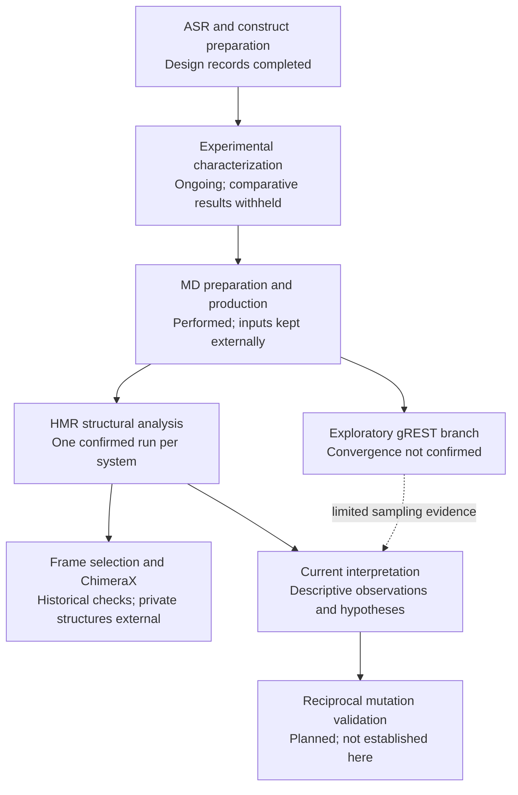
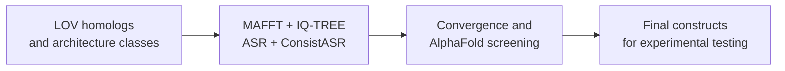

# Evolutionary Design Principles of LOV-Domain Photoreceptors

## Contents

- [Project Goal](#project-goal)
- [Scientific Motivation](#scientific-motivation)
- [Research Question](#research-question)
- [Project Workflow and Status](#project-workflow-and-status)
- [Current Interpretation and Validation Plan](#current-interpretation-and-validation-plan)
- [Repository Usage](#repository-usage)
- [Dataset Overview](#dataset-overview)
- [ASR Workflow](#asr-workflow)
- [Repository Structure](#repository-structure)
- [Candidate Selection](#candidate-selection)
- [Selected Constructs](#selected-constructs)
- [Structural Evaluation](#structural-evaluation)
- [Reproduction and Validation](#reproduction-and-validation)
- [Scope, Limitations, and Next Steps](#scope-limitations-and-next-steps)

## Project Goal

This repository documents an undergraduate graduation research project on the
evolutionary design principles of light-oxygen-voltage (LOV) photoreceptor
proteins.

The project uses phylogenetic analysis and ancestral sequence reconstruction
(ASR), sequence and structure analysis, and experimental characterization to
investigate LOV-domain diversification. ASR is used to identify experimentally
testable ancestral constructs rather than as an endpoint by itself. The main
comparison focuses on three signaling architectures:

- phototropin-like LOV2 proteins, represented by AsLOV2
- LOV-STAS proteins, represented by YtvA
- LOV-HTH proteins, represented by EL222

The broader goal is to investigate how a conserved LOV sensory core may have
become coupled to different signaling regions during evolution, and how those
evolutionary hypotheses can be examined through comparison of ancestral and
extant proteins.

## Scientific Motivation

LOV domains share a conserved flavin-binding sensory fold but occur in proteins
with different signaling partners and regulatory mechanisms. Comparing
reconstructed ancestors with extant reference proteins provides a way to
generate testable hypotheses about which sequence and structural features were
retained or changed as these signaling architectures diversified.

The project connects three levels of analysis: evolutionary history inferred
from sequence and phylogenetic evidence, structural hypotheses from reconstructed
proteins, and experimental characterization of selected ancestral/extant pairs.

## Research Question

> How did a conserved LOV light-sensing core diversify across different
> signaling architectures, and can reconstructed ancestral proteins provide
> testable candidates for studying that diversification?

The computational analysis generates candidates and hypotheses. It does not by
itself establish ancestral biochemical properties, photochemical kinetics,
expression behavior, or biological function.

## Project Workflow and Status

This is the project entry point. Design records are retained below; the
[documentation guide](docs/README.md) explains external experimental and MD
preparation requirements. Status reflects reviewed records, not a new analysis
or a claim that unpublished results are ready for release.

The arrows organize the research questions and evidence; they do not imply that
all experiments are finished or that each step is an executable pipeline.
**gREST is a separate exploratory branch from MD preparation, not a prerequisite
or continuation of the current HMR analysis.**

| Stage | Reviewed status | Detailed entry point |
|---|---|---|
| ASR and construct preparation | Candidate selection and six construct designs completed; expression/function not implied | [Construct design](results/construct_design/README.md) and [ASR workflow](#asr-workflow) |
| Experimental characterization | Expression, purification and spectroscopy pursued for the AsLOV2 pair; comparative results withheld | [Experimental status](docs/project_status.md#experimental-status) and [documentation guide](docs/README.md) |
| MD preparation and production | Existing topology/adduct/equilibration and completed production records reviewed; complete preparation recipe and build provenance remain external | [Preparation requirements](docs/README.md#required-inputs-and-dependencies) |
| HMR structural analysis | Existing analysis completed for one confirmed WT and one Anc run; independent-run validation pending | [HMR README](analysis/hmr/README.md) |
| Frame selection | Medoid plus seven diversity examples per system prepared historically; private structures withheld | [Frame-selection README](analysis/hmr/Ja_core_visual_fps8_20261019/README.md) |
| ChimeraX visualization | Historical native headless checks passed; GUI rendering/labels unverified | [ChimeraX README](analysis/hmr/chimerax/README.md) |
| Exploratory gREST | Four exchanging replicas/system, completed 50 ns set and earlier 10 ns pilot; convergence unconfirmed, primary quantitative ensemble use withheld | [gREST README](analysis/grest/README.md) |
| Interpretation and mutation validation | Mechanistic links remain hypotheses; reciprocal substitutions and controlled assays planned | [Interpretation and validation plan](#current-interpretation-and-validation-plan) |

## Current Interpretation and Validation Plan

The current comparison uses **one confirmed HMR production run for WT and one
for Anc** (run01 each), not replicated ensembles. Each contains 1,000 stored
frames over 0.01–10.00 ns. **gREST was attempted; convergence was not confirmed for the evaluated
length and metrics, so it was not used as primary evidence for quantitative
ensemble comparisons.** Archive/tutorial copies,
equilibration trajectories, and trajectory halves are not independent runs.

The gREST attempt used four exchanging replicas per system, with a completed
50 ns production set per system and an earlier 10 ns pilot. Replicas are not
independent runs. Exchange mixing and structural convergence are assessed
separately in [the gREST execution and convergence review](docs/grest_analysis.md).
Differences between effective-temperature states alone do not show nonconvergence.

### 1. Observations from experiment and MD

Expression, purification, and spectroscopy have been pursued for the AsLOV2
pair. Comparative experimental numbers are withheld here because permission to
release the unpublished results has not been established. This public update
does not claim a validated kinetic or stability difference.

Existing HMR analyses describe common-core-aligned Cα fluctuations, geometric
Jα–core contacts and secondary structure within the two available trajectories.
The checked analysis scope is summarized in [the methods](docs/hmr_analysis.md).
Unpublished effect sizes, residue-specific result tables and structure figures
are withheld pending release clearance. Analysis code is preserved under
[the HMR guide](analysis/hmr/README.md); no analysis was rerun for this update.

### 2. Hypotheses not yet validated

Changes in Jα–core packing or flexibility might contribute to altered signaling
or dark recovery. Contact and RMSF differences do **not** establish the cause of
dark recovery. Eyring activation quantities are kinetic-model-derived quantities,
not direct evidence of structural entropy. A447 loss is an absorbance-loss
readout under the measurement conditions, not a denaturation rate or Tm.

### 3. Current limitations and next experiments

Run-to-run reproducibility, convergence and equilibrium populations remain
unverified. The fixed Cys–FMN adduct cannot sample bond cleavage; a single
protein chain cannot establish protein–protein association. Direct MD sequence
correspondence does not resolve original ASR provenance, including the
WT119–124 boundary. Additional independent runs, mapping verification and
controlled dark-recovery measurements with reciprocal substitutions are needed
to test the hypotheses. A stability claim requires an appropriate independent
stability assay and model rather than relabeling A447 loss.

See [HMR methods and execution order](docs/hmr_analysis.md),
[public-release scope](docs/public_release_scope.md), and
[software versions](docs/software_environment.md).

## Repository Usage

- Follow [project workflow and status](#project-workflow-and-status) for the research sequence.
- Use the [documentation guide](docs/README.md) for experimental and MD preparation context.
- Use the [analysis guide](analysis/README.md) for HMR, frame selection, ChimeraX and gREST.
- See [`docs/project_status.md`](docs/project_status.md) for the retained progress record.
- Use `trees/` and `trees/comparison/` for phylogenetic outputs and topology comparisons.
- Use `constructs/` for candidate sequences and convergence summaries.
- Use `results/construct_design/` for construct rationale and final FASTA records.

Large intermediates, raw structure-prediction outputs, and raw experimental
records are maintained outside this repository.

## Dataset Overview

| Branch | Biological scope | Architectures in candidate analysis |
|---|---|---|
| Phototropin-like LOV2 | Plant-like phototropin sequences related to AsLOV2 | Phototropin-like LOV2 |
| Bacterial LOV-associated | Bacterial LOV proteins grouped by signaling region | LOV-STAS, LOV-HTH, LOV-HK |

## ASR Workflow

Key steps: LOV homolog collection and domain classification → MAFFT alignment
(AUTO, L-INS-i, E-INS-i, G-INS-i) → IQ-TREE phylogenetic inference and topology
comparison → ASR with ConsistASR indel-aware refinement → cross-alignment
candidate convergence and AlphaFold screening → literature-guided construct
boundary mapping → final FASTA preparation → preliminary experimental
characterization.

Software tools and versions are listed in
[`docs/software_environment.md`](docs/software_environment.md).

## Repository Structure

| Path | Contents |
|---|---|
| `constructs/` | Candidate ancestral sequences, pairwise identity summaries, consensus comparisons, and construct-design working files |
| `constructs/bacterial/` | Bacterial LOV-STAS, LOV-HTH, and LOV-HK ancestral candidates |
| `constructs/plant/` | Plant phototropin-like ancestral candidates from multiple alignment strategies |
| `constructs/construct_design/` | Reference sequences, alignments, extraction script, and intermediate outputs |
| `results/construct_design/` | Reviewed construct rationale and final construct records |
| `results/construct_design/final_order_fastas/` | Combined FASTA files for selected constructs |
| `trees/` | Bacterial and plant IQ-TREE tree files |
| `trees/comparison/` | Pairwise topology comparison tables and matrices |
| `scripts/` | Domain-architecture classification utility |
| `docs/` | [Project progress, methods and release-scope documentation](docs/README.md) |
| `analysis/` | [MD analysis navigation](analysis/README.md) and external-input code snapshots |
| `analysis/hmr/` | [HMR structural analysis](analysis/hmr/README.md), frame selection and ChimeraX guides |
| `analysis/grest/` | [Separate exploratory sampling review](analysis/grest/README.md), code and compact diagnostics |

## Candidate Selection

The selected ancestral design sources were:

- plant phototropin-like: `plant_linsi_Node62`
- LOV-STAS: `bacterial_ginsi_STAS_Node227`
- LOV-HTH: `bacterial_ginsi_HTH_Node83`

Evaluation criteria included sequence convergence across alignment strategies,
LOV cysteine conservation, indel-aware sequence composition, AlphaFold
structural plausibility, and compatibility with literature construct boundaries.
LOV-HK candidates are retained in the repository but not included in the
current six-construct set.

Pairwise identity tables: `constructs/plant_pairwise.tsv`,
`constructs/stas_pairwise.tsv`, `constructs/hth_pairwise.tsv`.

## Selected Constructs

| Construct | Reference boundary | Length | Status |
|---|---:|---:|---|
| `WT_AsLOV2_404_560` | AsLOV2 404–560 | 157 aa | Preliminary lab work ongoing |
| `AncPlant_Node62_AsLOV2_404_560eq` | AsLOV2 404–560 equivalent | 157 aa | Preliminary lab work ongoing |
| `WT_YtvA_20_147` | YtvA 20–147 | 128 aa | Design prepared |
| `AncSTAS_Node227_YtvA_20_147eq` | YtvA 20–147 equivalent | 128 aa | Design prepared |
| `WT_EL222_1_163` | EL222 1–163 | 163 aa | Design prepared |
| `AncHTH_Node83_EL222_1_170eq` | EL222 1–170 equivalent | 148 aa | Design prepared |

Detailed boundary rationale: [`results/construct_design/README.md`](results/construct_design/README.md).
Final FASTA records: [`results/construct_design/final_order_fastas/all_WT_and_ancestral_order_constructs.fasta`](results/construct_design/final_order_fastas/all_WT_and_ancestral_order_constructs.fasta).

## Structural Evaluation

AlphaFold-based predictions were used as a computational screening layer for
fold conservation and domain organization. Structure prediction was one
component of candidate selection and was not treated as evidence of biochemical
activity or experimental structural validation. Raw outputs are maintained
outside this repository.

## Reproduction and Validation

Required input files and dependencies vary by stage. ASR tools and recorded
versions are listed in [software_environment.md](docs/software_environment.md).
Existing construct outputs are in `results/construct_design/`; experimental raw
records and MD preparation inputs remain external. HMR and gREST scripts also
require private topology/trajectory files, mappings and caches. They are
historical snapshots, not a standalone workflow runnable from a fresh clone.

Follow the conditional execution examples in the [analysis guides](analysis/README.md).
The HMR order is structural analysis → matched-atom control → optional frame
selection → viewer configuration → ChimeraX. gREST independently uses exchange
QC and physical-state reconstruction followed by existing structural stability
checks. Generated research outputs remain external unless explicitly cleared.

This documentation update checks English prose, relative links, directory
navigation, syntax and provenance. It does not rerun analysis, submit simulation
jobs or generate new research results. Historical validation status and remaining
limitations are recorded separately in each directory README.

## Scope, Limitations, and Next Steps

Current limitations include incomplete provenance documentation for the initial
sequence collection, unrecorded intermediate filtering counts, and node
identifiers that must always be interpreted alongside their source analysis.
Phylogenetic reconstruction and AlphaFold prediction generate hypotheses;
neither substitutes for experimental validation.

Planned next steps: maintain a canonical construct manifest with source and
boundary rationale; record exact software versions, commands, and input
provenance; continue controlled expression, purification, and spectroscopy
comparisons; add raw experimental data only after organizing with clear
provenance; and compare future measurements with computational hypotheses
without overstating agreement.
