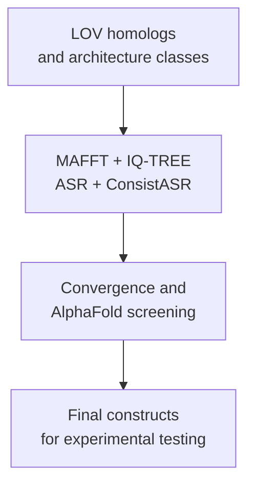

# Evolutionary Design Principles of LOV-Domain Photoreceptors

An undergraduate research project combining ancestral sequence reconstruction
(ASR), structural analysis and experimental characterization of LOV photoreceptors.
The project compares phototropin-like LOV2, LOV-STAS and LOV-HTH architectures,
with experimental and MD work currently focused on the AsLOV2 extant/ancestral pair.

## Research Question

How do evolutionary sequence changes alter coupling between the conserved LOV
sensory core and its signaling regions?

## Project Workflow and Status

| Stage | Status | Documentation |
|---|---|---|
| ASR and construct design | Candidate selection and six construct designs completed | [Construct design](results/construct_design/README.md) |
| Experimental characterization | AsLOV2 characterization ongoing; mutation validation in preparation | [Project status](docs/project_status.md) |
| Structural MD | Historical WT/Anc HMR analysis and rebuilt WT157 comparisons available; mutant screening ongoing | [Analysis guide](analysis/README.md) |
| Exploratory gREST | Exchange diagnostics reviewed; structural convergence unconfirmed | [gREST review](docs/grest_analysis.md) |

The latest documented mutant analysis covers four single-trajectory systems as
of October 30, 2026. Detailed run conditions and evidence limits are in the
[status record](docs/project_status.md).

## Repository Usage

| Path | Contents |
|---|---|
| [docs/](docs/README.md) | Status, methods, software records and public content scope |
| [analysis/](analysis/README.md) | HMR, frame-selection, ChimeraX and gREST code snapshots |
| [constructs/](constructs/README.md) | Candidate sequences, alignments, consensus and design inputs |
| [results/construct_design/](results/construct_design/README.md) | Final construct rationale and FASTA records |
| [trees/](trees/README.md) | Canonical phylogenies and topology comparisons |
| scripts/ | LOV domain-architecture classification utility |

## Dataset Overview

| Branch | Biological scope | Architectures in candidate analysis |
|---|---|---|
| Phototropin-like LOV2 | Plant-like phototropin sequences related to AsLOV2 | Phototropin-like LOV2 |
| Bacterial LOV-associated | Bacterial LOV proteins grouped by signaling region | LOV-STAS, LOV-HTH, LOV-HK |

## ASR Workflow

Key steps: LOV homolog collection and domain classification → MAFFT alignment
(AUTO, L-INS-i, E-INS-i, G-INS-i) → IQ-TREE phylogenetic inference and topology
comparison → ASR with ConsistASR indel-aware refinement → cross-alignment
candidate convergence and AlphaFold screening → literature-guided construct
boundary mapping → final FASTA preparation → preliminary experimental
characterization.

Software tools and versions are listed in
[`docs/software_environment.md`](docs/software_environment.md).

## Candidate Selection

The selected ancestral design sources were:

- plant phototropin-like: `plant_linsi_Node62`
- LOV-STAS: `bacterial_ginsi_STAS_Node227`
- LOV-HTH: `bacterial_ginsi_HTH_Node83`

Evaluation criteria included sequence convergence across alignment strategies,
LOV cysteine conservation, indel-aware sequence composition, AlphaFold
structural plausibility, and compatibility with literature construct boundaries.
LOV-HK candidates are retained in the repository but not included in the
current six-construct set.

Pairwise identity tables: `constructs/plant_pairwise.tsv`,
`constructs/stas_pairwise.tsv`, `constructs/hth_pairwise.tsv`.

## Selected Constructs

| Construct | Reference boundary | Length | Status |
|---|---:|---:|---|
| `WT_AsLOV2_404_560` | AsLOV2 404–560 | 157 aa | Preliminary lab work ongoing |
| `AncPlant_Node62_AsLOV2_404_560eq` | AsLOV2 404–560 equivalent | 157 aa | Preliminary lab work ongoing |
| `WT_YtvA_20_147` | YtvA 20–147 | 128 aa | Design prepared |
| `AncSTAS_Node227_YtvA_20_147eq` | YtvA 20–147 equivalent | 128 aa | Design prepared |
| `WT_EL222_1_163` | EL222 1–163 | 163 aa | Design prepared |
| `AncHTH_Node83_EL222_1_170eq` | EL222 1–170 equivalent | 148 aa | Design prepared |

Detailed boundary rationale: [`results/construct_design/README.md`](results/construct_design/README.md).
Final FASTA records: [`results/construct_design/final_order_fastas/all_WT_and_ancestral_order_constructs.fasta`](results/construct_design/final_order_fastas/all_WT_and_ancestral_order_constructs.fasta).

## Reproduction and Validation

Use the [software records](docs/software_environment.md) and stage-specific
[analysis guides](analysis/README.md) for dependencies, input layout and commands.
MD snapshots depend on external trajectories, topology, mapping and cache files.
Restore those inputs before execution. Several historical scripts execute work
on import. Initial sequence-collection provenance, database releases and some
run/build records remain to be consolidated.

ASR and structure prediction generate experimentally testable candidates.
Contact and fluctuation analyses describe sampled structures; their contribution
to activation thermodynamics remains unquantified. Historical WT/Anc HMR uses
one confirmed run per system. Replicate simulations and matched conditions are
required for stronger comparisons. See the [methods](docs/hmr_analysis.md).

Public content follows the [release scope](docs/public_release_scope.md).
